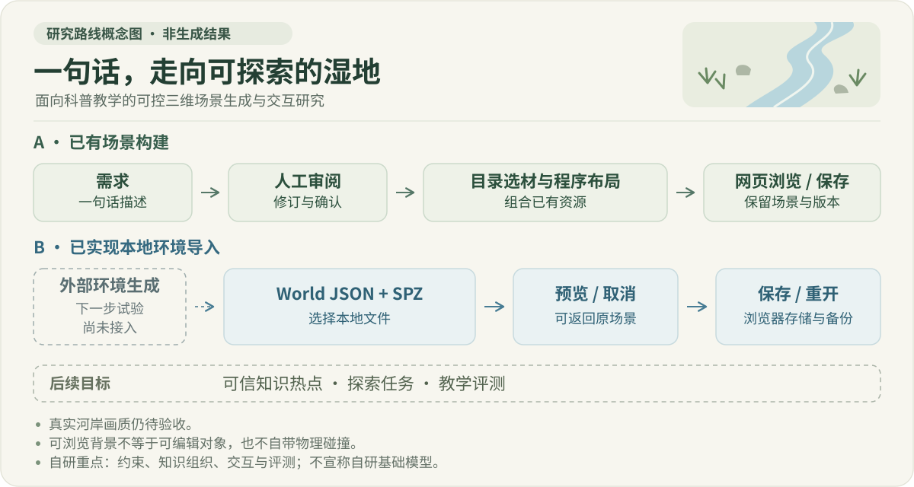
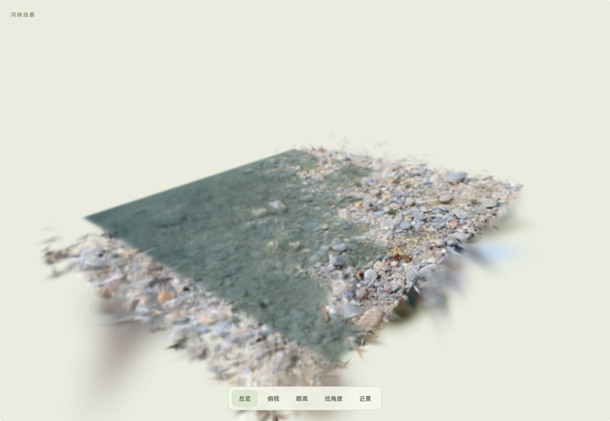
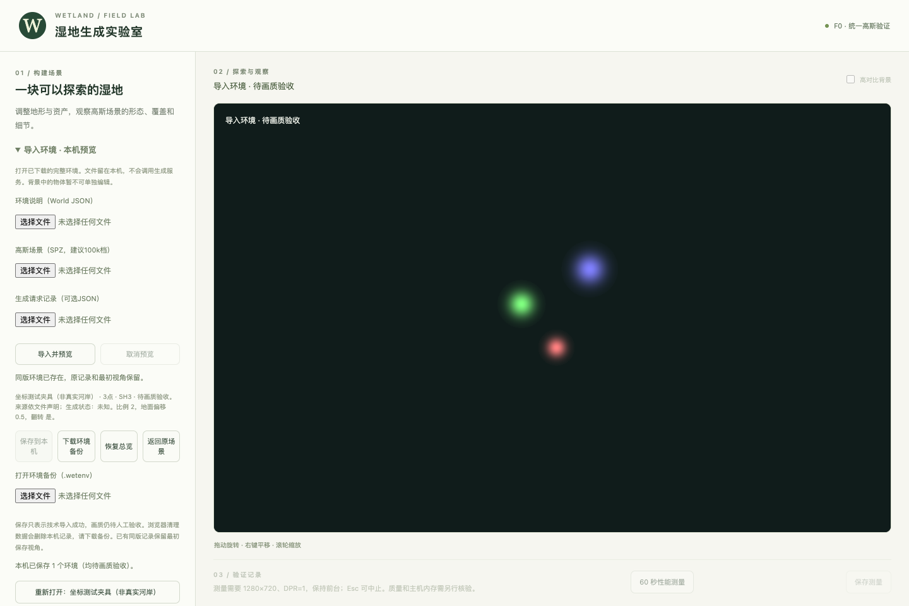
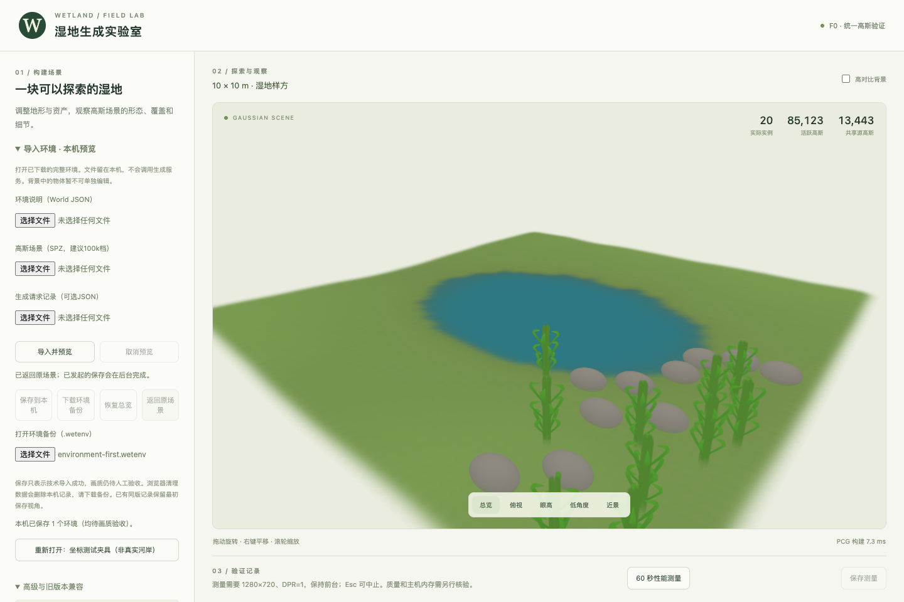

# Gaussian Scene Studio

### From one sentence to a reviewable, editable Gaussian scene

An undergraduate research prototype developing a general scene pipeline: asset-aware local AI planning, parametric terrain and static water, constrained assembly and stable editing. Wetlands and forests are examples, not the only supported scene template.

[中文](README.md) · [Local models](docs/LOCAL_MODELS.md) · [Third-party notices](THIRD_PARTY_NOTICES.md)



> **2026-10-18: ordinary workbench integration in progress.** Engineering work has reached transaction control through Task 12; Task 13 now exposes “生成自然场景” (Generate a natural scene) on the ordinary homepage. The first Chrome integration run passed 3/3 cases: entry visibility, per-role confirmation and actual draft saving with constructed assets/model replies, and manual preview after a model outage. The full browser matrix remains pending. Task 8 still fails visual acceptance for riverbank steps, soft bands and outlet stripes. Real-model, final visual and performance acceptance remain incomplete. Historical images below do not establish acceptance of this pipeline.

## Research questions

A request such as “a riverbank with low grasses and stones” raises concrete questions: is the river present, do plants obscure it, are stones scanned or procedural, and can the terrain support the layout?

- **Reviewable intent:** editable requirements, visible conflicts and missing resources, followed by human confirmation.
- **Reproducible results:** asset identity, seeds, versions and camera state retained through local saves.
- **Educational interaction:** future knowledge hotspots and exploration tasks on manually reviewed scenes, followed by learning evaluation.

Our work concerns constraints, knowledge organization, interaction and evaluation. Foundation models, world-generation backends and scans come from existing third-party work.

## Actual browser previews



**Riverbank candidate — actual screenshot.** Riverside is by [VeryOS](https://superspl.at/scene/8f52baf1), [CC BY 4.0](https://creativecommons.org/licenses/by/4.0/), used as an attributed continuous crop. Water is procedural Gaussian data. This controlled preview is not evidence of successful prompt-to-world generation. Scan softness, flat water and clipped boundaries still fail visual acceptance. [Results](docs/validation/riverbank-review-preview-results.md)

| Local environment import | Original scene restored |
|---|---|
|  |  |
| World JSON + SPZ → preview → save → reload/reopen. These points are a **self-authored fixture**, not a generated riverbank. | Cancel/return preserves the scene and camera. This image shows the **procedural baseline**. |

[Import evidence](docs/validation/environment-import-results.md) · [Image provenance](docs/images/README.md)

## Current progress

Documentation updated **2026-10-18**. The general pipeline now includes asset contracts, terrain/static water, constrained assembly, persistence, local editing and transaction control. Task 13 UI integration and cross-mode regression work continue; Task 14 real-asset, local-model, visual and performance evaluation is pending. [Implementation scope](docs/superpowers/plans/2026-10-09-general-gaussian-scene-generation.md) · [Historical progress through October 13](docs/validation/general-scene-progress-2026-10-13.md).

**Real asset admission still blocks generation.** The local general catalog contains three candidates and no admitted terrain/water style; an unconfigured catalog is empty. The ordinary UI reports missing resources, and manual settings do not bypass admission. The first three integration cases use isolated, explicitly constructed assets and model replies with real rendering and native IndexedDB. They do not establish real-asset quality or arbitrary-language generation. Task 8 engineering reviews do not override its visual failure.

### Generate a natural scene (Task 13 in development)

The ordinary homepage exposes the Chinese “生成自然场景” panel without an engineering query. Enter a description, choose “解析场景要求”, review requirements, suggestions and missing resources, and confirm procedural sources for each role. An explicit dry request remains distinct from unspecified water. “生成预览” displays a candidate; “使用并保存草稿” commits a local draft while retaining pending visual/performance checks.

A fresh install needs no separate asset library: the bundled [starter library](docs/validation/starter-library.md) (procedural rock, low grass, reed and one terrain/water surface style, redistributable with the project) loads automatically, so a scene can be generated and saved without the local model.

When the model is unavailable, “手工设置” offers manual controls and explicitly states that complete coverage of the original sentence is unverified. Saved-scene controls provide reopening, local editing, undo and export. Local edits require review of the requested region R, effective region H and changed objects before preview. Archives with missing exact dependencies are readonly; unknown versions retain their original bytes for download. These extended UI paths still await the full browser run. [Usage guide](使用说明.md) (Chinese).

### Existing workbench (compatibility route)

The compatibility routes below retain their existing formats and historical evidence.

| Area | Implemented | Remaining limits |
|---|---|---|
| Catalog and local AI | Seven entries: four trial assets and three compatibility entries; editable requirements, candidate IDs, source confirmation and missing-asset feedback | Small catalog; arbitrary language and cross-environment behavior unverified |
| Procedural placement | Seeded layouts with boundary, water-level, slope, spacing and support checks; shortfalls reported | Height proxies are not exact collision or ecological validation |
| Riverbank review / water intent v2 | Cancellable previews and save-on-use; required water separated from a known numeric level | Unknown geometry stays pending; the original request has not produced an accepted scene end to end |
| Local environment import | World JSON + SPZ; preview/cancel, IndexedDB save/reopen and `.wetenv` backups | No integrated paid generation; real-asset quality and large-scene performance unverified |
| Versioned assets | Legacy archives, controlled ground admission and optional offline SH3 range correction | No silent replacement; color corrections do not repair geometry |
| Ecological education | Wetland theme and interaction direction selected | Hotspots, exploration tasks and teaching evaluation are future work |

Import supports **gzip SPZ v2/v3, SH0–3**, up to 250,000 points, 64MiB source bytes and 32MiB streamed expansion. SPZ v4 is rejected. Start with a 100k asset. Storage permits eight environments / 128MiB total source bytes. A successful save does not establish visual quality.

Catalog scenes allow 20 instances and 250,000 active Gaussians. The Riverside crop has 64,949 SH3 Gaussians; its 4×4 extent uses display units, not surveyed meters. Whole-environment splats do not automatically provide editable objects, species labels or collision.

## Run locally

Requires Node.js, npm and a WebGL2 desktop browser. Tested on Node 25.7.0, npm 11.10.1, macOS / Apple M5 16GB and Google Chrome. Other platforms have not received equivalent validation.

```sh
npm ci
npm run dev
```

Open <http://127.0.0.1:4173/>. The ordinary natural-scene panel offers description parsing and an explicit manual route. Both require admitted assets and styles; the current real catalog reports missing resources instead of bypassing this requirement.

The earlier workbench still offers manual parameters and an offline example. Drag to orbit, right-drag to pan and scroll to zoom. Open older scene ZIPs through their compatibility controls.

The environment panel accepts local World JSON and SPZ files. Preview before saving or downloading a `.wetenv` backup. General-scene ZIPs, older scene ZIPs and environment backups use their corresponding import controls. Importing SPZ does not call a generation service.

### Optional local AI

The earlier workbench was tested with **Qwen2.5-3B-Instruct Q4_K_M + llama.cpp**. Follow [setup instructions](docs/LOCAL_MODELS.md). The ordinary natural-scene panel reuses the local planning service, but its real-model end-to-end evaluation remains pending. The compatibility planning route is `/?planner=3b`; the historical riverbank review candidate is `/?review=1&planner=3b`. Prompts and UI are primarily Chinese; equivalent English behavior is not validated.

No weights or provider keys are bundled. A default-fallback message means the request was not interpreted by a model. Procedural grasses, reeds and added stones cannot silently satisfy a request for scanned assets.

Mac `.command` shortcuts require the original machine's existing runtime and verified weights. They do not install a runtime or download models. Configure a new machine manually.

**Qwen 3B uses the Qwen Research License for non-commercial research/evaluation.** Do not apply the 7B model's Apache-2.0 license to it. [Notices](THIRD_PARTY_NOTICES.md)

## Structure and validation

| Path | Responsibility |
|---|---|
| `src/general-scene/` | General assets, planning, terrain, water, persistence, editing and ordinary UI (in development) |
| `src/selection/`, `src/planner/` | Requirements, catalog selection and local model adapters |
| `src/review-v2/` | Water intent and versioned review contracts |
| `src/environment/` | SPZ validation, preview lifecycle, storage and backups |
| `src/assets/`, `src/terrain/` | Catalog, procedural assets, placement and terrain proxies |
| `src/gaussian/`, `src/io/` | Spark rendering, lifecycle and versioned archives |
| `scripts/`, `tests/` | Local tooling, browser checks and fixtures |

TypeScript, Vite, Three.js, Spark, Vitest and Playwright form the stack, with versions pinned in the lockfile. The planning API runs with Vite's development/preview server; static hosting alone does not provide inference.

The first Task 13 Chrome integration run on 2026-10-18 passed only three cases with constructed assets/model replies and no real-model calls. The expanded browser matrix and a complete workflow video of at least 30 seconds remain pending; discovered tests are not passed tests.

Historical workbench checks, not final acceptance of the new pipeline, on 2026-10-07: **514 unit + eight launcher tests, type checking and production build passed; Chrome functional checks: 110 passed / 15 conditional skips.** Eight legacy visual cases were excluded. This does not claim that all browser tests or visual quality pass. Independent review found an initialization timeout/cancellation issue, fixed with regressions observed failing before the fix and passing afterward.

```sh
./node_modules/.bin/vitest run
node --test scripts/launcher.test.mjs
npm run typecheck
npm run build
# The functional scope reported above:
npx playwright test --project=functional --grep-invert 'offline river visibility'
```

Browser checks use installed Google Chrome and local port 4173. `npm run test:e2e` includes additional visual cases. A large-chunk build warning remains.

[Environment import](docs/validation/environment-import-results.md) · [Water intent v2](docs/validation/water-semantics-v2-results.md) · [Riverbank review](docs/validation/riverbank-review-preview-results.md) · [Controlled ground admission](docs/validation/controlled-ground-admission-results.md) · [SH3 import](docs/SH_IMPORT.md)

## Next development steps

Complete Task 13 reviews, the full ordinary-UI regression and workflow recording, then perform Task 14 real-asset and local-model evaluation. Resolve Task 8 visual failures and asset admission separately. A usable preview or committed draft does not automatically pass visual or performance acceptance. Legacy modes and archives remain compatible.

World Labs and paid generation services, foundation-model training, dynamic water and leaf animation are outside this stage. Knowledge hotspots and teaching evaluation remain later research. Engineering tests do not establish natural appearance or a complete prompt-to-scene workflow.

## Licensing and acknowledgements

Original code has **no selected project-wide open-source license**. Public visibility does not grant blanket MIT terms. Dependencies, models and assets retain their own licenses.

Thanks to Spark, Three.js, Qwen, VeryOS, Marcel Padilla and Loop CE. Distributed assets retain source, CC BY 4.0 attribution and modification notices. The `starter-library/` examples are generated by this project's own code and may be redistributed with the project. Weights, personal saves, provider keys, large raw scans and private logs are excluded. [Third-party notices](THIRD_PARTY_NOTICES.md)
